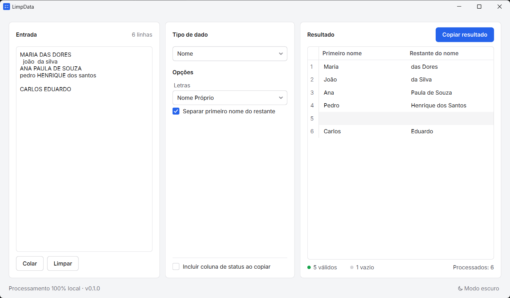
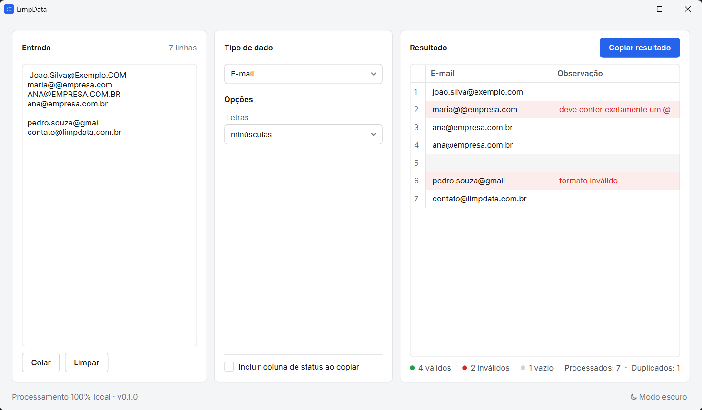
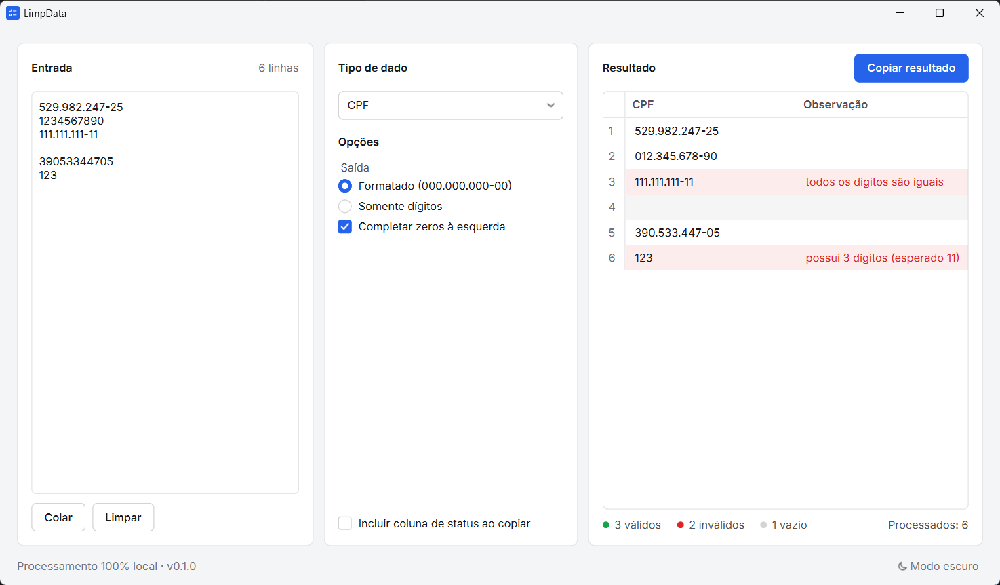
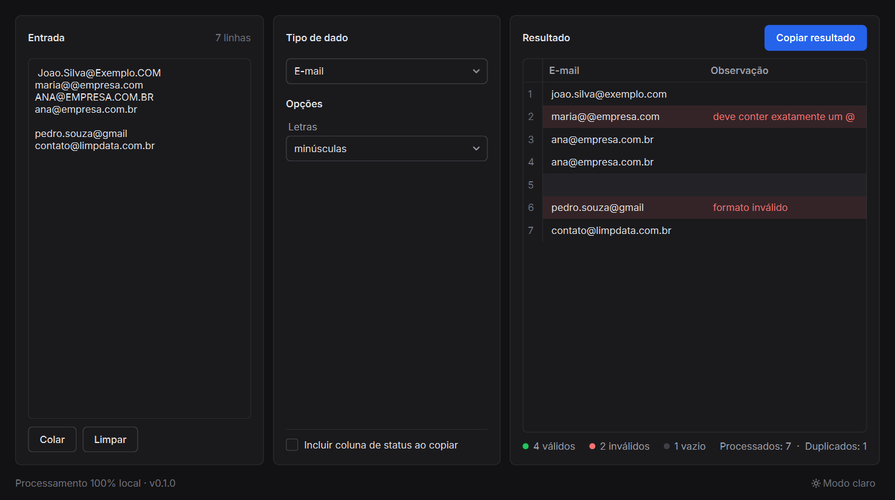
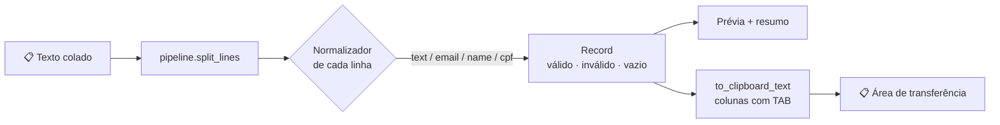

<div align="center">


# LimpData

**Cole uma coluna da planilha, escolha o tipo de dado e copie o resultado limpo.**

Aplicativo desktop gratuito e open source para Windows que normaliza nomes, e-mails, CPFs e textos.
Sem cadastro, sem internet, e nenhum dado sai do seu computador.


### [⬇️ Baixar o LimpData para Windows](../../releases/latest/download/LimpData.exe)

<sub>Arquivo único, sem instalação · [todas as versões](../../releases)</sub>

<br>



</div>

---

## ✨ Por que usar

|---|---|
| 📋 **Copiar e colar** | Cole direto do Excel ou do Google Sheets e cole o resultado de volta. A ordem e a quantidade de linhas são preservadas. |
| 🔒 **Privado por padrão** | Funciona 100% offline. Não usa APIs externas, não grava logs com os seus dados e não salva o que você colou. |
| 🚦 **Nada some em silêncio** | A prévia mostra só o resultado a copiar. Registros inválidos ficam destacados em vermelho e ganham uma coluna **Observação** com o motivo; se tudo estiver válido, ela nem aparece. |
| 📊 **Resumo na hora** | Contagem de registros processados, válidos, inválidos, vazios e duplicados. |
| 🌗 **Modo claro e escuro** | Alterne no rodapé; a barra de título do Windows acompanha o tema e o app lembra a sua escolha. |
| ↹ **Pronto para planilhas** | Quando há mais de uma coluna de saída, os campos são separados por tabulação. |

## 🧰 O que ele normaliza

<table>
<tr><th>Tipo</th><th>Antes</th><th>Depois</th><th>Opções</th></tr>
<tr>
  <td>🧽 <b>Limpeza geral</b></td>
  <td><code>␣␣Produto​␣␣␣azul␣</code></td>
  <td><code>Produto azul</code></td>
  <td>Remover espaços nas pontas, espaços repetidos, caracteres invisíveis e linhas vazias</td>
</tr>
<tr>
  <td>✉️ <b>E-mail</b></td>
  <td><code>␣Joao.Silva@Exemplo.COM</code></td>
  <td><code>joao.silva@exemplo.com</code></td>
  <td>minúsculas, MAIÚSCULAS ou manter, com validação de sintaxe</td>
</tr>
<tr>
  <td>👤 <b>Nome</b></td>
  <td><code>MARIA DAS DORES</code></td>
  <td><code>Maria das Dores</code></td>
  <td>Nome Próprio (com <i>de, da, das, do, dos, e</i>), MAIÚSCULAS, minúsculas e separar o primeiro nome</td>
</tr>
<tr>
  <td>🪪 <b>CPF</b></td>
  <td><code>1234567890</code></td>
  <td><code>012.345.678-90</code></td>
  <td>Formatado ou só dígitos; valida os dígitos verificadores e completa zeros perdidos pela planilha</td>
</tr>
</table>

<details>
<summary>📸 <b>Mais capturas de tela</b></summary>
<br>

**E-mails**: e-mails inválidos aparecem destacados, com o motivo.



**CPF**: valida os dígitos verificadores e recupera zeros à esquerda.



**Modo escuro**: alterne pelo botão no rodapé.



</details>

## ⬇️ Download

1. Baixe o **[LimpData.exe](../../releases/latest/download/LimpData.exe)** da versão mais recente (ou escolha uma versão na página [Releases](../../releases)).
2. Dê dois cliques para abrir. Não precisa instalar nem ter Python.

> [!NOTE]
> Por ser um programa novo e sem assinatura digital, o Windows pode mostrar o aviso **"O Windows protegeu o computador"**. Clique em **Mais informações** → **Executar assim mesmo**. O executável é gerado automaticamente pelo GitHub a partir deste código-fonte, e cada build pode ser conferido na aba [Actions](../../actions).

## 🚀 Como usar

1. Na planilha, selecione **uma coluna** e copie (<kbd>Ctrl</kbd>+<kbd>C</kbd>).
2. No LimpData, clique em **Colar** (ou cole no campo **Entrada**).
3. Escolha o **Tipo de dado** e ajuste as **Opções**. A prévia é atualizada na hora.
4. Clique em **Copiar resultado** (<kbd>Ctrl</kbd>+<kbd>Shift</kbd>+<kbd>C</kbd>) e cole na planilha.

> [!TIP]
> Marque **Incluir coluna de status ao copiar** para levar junto, numa coluna ao lado, o status de cada linha (`válido`, `vazio` ou `inválido: motivo`). Assim fica fácil filtrar os problemas na planilha.

> [!IMPORTANT]
> Ao colar CPFs **só com dígitos** no Excel, formate a coluna de destino como **Texto** antes de colar. Caso contrário, o Excel remove os zeros à esquerda.

## 💻 Executar a partir do código-fonte

Requer **Python 3.12** no Windows.

```powershell
# 1. Criar e ativar o ambiente virtual
py -3.12 -m venv .venv
.\.venv\Scripts\Activate.ps1

# 2. Instalar as dependências (app + testes + build)
pip install -r requirements-dev.txt

# 3. Abrir o aplicativo
python main.py          # ou: python -m limpdata
```

## 🧪 Testes

```powershell
python -m pytest
```

Os testes cobrem casos válidos, inválidos, vazios, duplicados e limites de cada módulo, além de um teste da interface que roda sem abrir janela.

## 📦 Gerar o executável (.exe)

O repositório guarda só o código-fonte. O `.exe` é gerado pelo **GitHub Actions** ([`.github/workflows/release.yml`](.github/workflows/release.yml)) e publicado em [Releases](../../releases).

| Quando | O que acontece |
|---|---|
| Envio para `main` ou pull request | Roda os testes. |
| Envio de uma tag `v*` (ex.: `v0.2.0`) | Roda os testes, gera o `LimpData.exe` e publica uma Release com ele. |
| Botão **Run workflow** na aba Actions | Gera o `.exe` como artefato para teste, sem publicar. |

### Publicar uma nova versão

1. Atualize a versão em [`limpdata/__init__.py`](limpdata/__init__.py) (`__version__`) e em [`pyproject.toml`](pyproject.toml).
2. Faça o commit e envie para o GitHub.
3. Crie e envie a tag com o mesmo número:

```powershell
git tag v0.2.0
git push origin v0.2.0
```

Em poucos minutos a Release aparece com o novo `LimpData.exe`, e o link de download do topo deste README passa a apontar para ele. Se a tag não bater com `__version__`, o build para com um erro.

### Gerar localmente

```powershell
.\build.ps1
```

O script roda os testes e, se tudo passar, gera **`dist\LimpData.exe`**. A configuração do PyInstaller fica em [`limpdata.spec`](limpdata.spec).

## 🏗️ Arquitetura

A interface gráfica é separada da lógica de normalização. Os módulos em `limpdata/core` não dependem do Qt e podem ser testados ou reaproveitados sozinhos.



```text
limpdata/
├── core/                 # regras de negócio, sem interface
│   ├── models.py         # Record, Status, Summary, Result
│   ├── textutils.py      # limpeza básica compartilhada
│   ├── pipeline.py       # processamento das linhas e texto para copiar
│   ├── text.py           # limpeza geral
│   ├── email.py          # e-mails
│   ├── name.py           # nomes
│   └── cpf.py            # CPF
└── gui/                  # interface PySide6
    ├── app.py            # QApplication
    ├── main_window.py    # janela principal (entrada · comandos · resultado)
    ├── theme.py          # cores, fonte e folha de estilo dos temas claro/escuro
    ├── titlebar.py       # barra de título do Windows no tema do app
    ├── assets/           # fonte Inter, ícones e logo
    ├── option_panels.py  # painel de opções de cada tipo
    └── result_model.py   # tabela de prévia
tests/                    # pytest
.github/workflows/        # testes e geração do .exe no GitHub Actions
main.py                   # ponto de entrada (usado pelo PyInstaller)
```

### Adicionar um novo tipo de dado

1. Crie `limpdata/core/<tipo>.py` com uma dataclass de opções e uma função `normalize_<tipo>(valor, opcoes) -> Record`.
2. Crie `tests/test_<tipo>.py`.
3. Crie um painel em `gui/option_panels.py` e registre-o na lista `PANELS`.

## 🔐 Privacidade

- ❌ Sem conexão com a internet, APIs externas ou telemetria.
- ❌ Sem logs dos valores processados.
- ❌ Sem salvamento automático da entrada. Ao fechar o app, os dados somem.
- ✅ Os dados só saem do app quando você clica em **Copiar resultado**.

## 🗺️ Próximos passos

- [ ] 📞 Telefones brasileiros (DDD, +55, nacional/internacional, WhatsApp/SMS, máscara personalizada)
- [ ] 🏢 CNPJ (validação e formatação)

## 📄 Licença

Distribuído sob a licença [MIT](LICENSE). A fonte Inter é distribuída sob a [SIL Open Font License](limpdata/gui/assets/fonts/OFL-Inter.txt).
